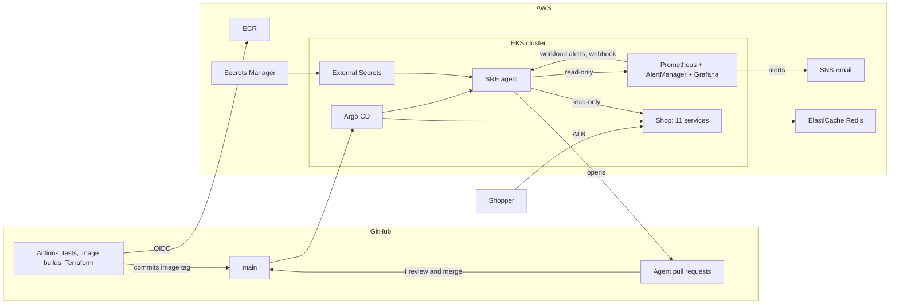

# Online Boutique on AWS EKS, with an AI SRE agent

A microservices platform on AWS EKS that I built in stages, from Terraform to
GitOps. On top of it runs an AI SRE agent that investigates alerts and
proposes fixes as pull requests. A human approves every change.

The shop is Google's Online Boutique, moved from GCP to AWS. The agent is
mine ([`src/sreagent`](src/sreagent/)), and so is an evaluation that checks
it in CI.

**At a glance**

- 7 real incidents, 6 fixed by the agent's pull requests
- 0 wrong answers allowed to make a change
- About 5 cents and 13 seconds per investigation (a small sample; see
  [Monitoring the agent](#monitoring-the-agent))

## Architecture



- **Terraform** builds everything in AWS and installs the cluster's
  platform: load balancer controller, External Secrets, monitoring, Argo CD.
- **GitHub Actions** tests pull requests and builds the images. After a
  merge it commits the new image tag to
  `helm/online-boutique/values-dev.yaml`.
- **Argo CD** deploys the Helm chart from `main`. Nothing else writes to the
  application namespace.
- **The agent** reads the cluster, Prometheus and the repository. Its only
  write is a pull request on `values-dev.yaml`.

## How the platform evolved

| Phase | When | What | Why |
|---|---|---|---|
| Foundations | Oct 2025 – Feb 2026 | Terraform (8 modules). Kustomize manifests, deployed by a GitHub Actions workflow (`kubectl apply`). Image builds to ECR. A separate security-scan workflow, tried and removed | Get the shop running on AWS, end to end |
| Platform hardening | Feb – Apr 2026 | HPA (70% CPU) and PDB for every service. A Helm chart replacing Kustomize. Unit tests in all five languages. Prometheus alert rules. CloudWatch alarms for RDS and Redis. Automated rollback in the Helm deploy workflow. Grafana Cloud remote write | Availability during node drains (PDB). No account IDs in the chart: everything passed at deploy time |
| Cleanup and secure delivery | 23 – 31 Aug 2026 | Grafana Cloud removed, monitoring made private ([#1](https://github.com/kolade86/online-boutique-aws-eks/pull/1)). No hardcoded AWS account in CI. Builds gated on tests. Node 24. Terraform CI/CD: checks with no credentials, plan, manual apply, OIDC ([#11](https://github.com/kolade86/online-boutique-aws-eks/pull/11)) | The repo can point at throwaway sandbox accounts, and nothing is exposed that need not be |
| GitOps | 30 Aug 2026 | Argo CD with automated sync, self-heal and prune ([#8](https://github.com/kolade86/online-boutique-aws-eks/pull/8), [#9](https://github.com/kolade86/online-boutique-aws-eks/pull/9)). The Helm deploy workflow retired | Every deploy is a commit, and `git revert` is the rollback. One writer to the cluster |
| SRE agent | 4 – 17 Oct 2026 | The agent, its evidence score and safety rules, incident grouping, evaluation, a chat page, metrics and a dashboard ([#13](https://github.com/kolade86/online-boutique-aws-eks/pull/13) onwards). Seven incidents, six injected | An agent that finds the cause and proposes the fix, with a human in the loop |

Three moves worth knowing:

- **Helm took over the Kustomize resources in place.** A one-time step
  labelled the existing objects with Helm's ownership metadata, so
  `helm upgrade --install` adopted them instead of recreating them.
- **What I removed, and why:**
  - **Grafana Cloud:** monitoring is in-cluster and private now.
  - **The automated-rollback deploy workflow:** Argo CD deploys, and a
    revert commit is the rollback.
  - **The nginx placeholder for the shopping assistant:** it made the shop
    advertise an assistant that could not answer. The assistant needs Gemini
    and AlloyDB, so it is now not deployed at all.
- **Kept for reference only:** `k8s/` (the Kustomize manifests), and
  `.github/workflows/deploy.yml.disabled` and `helm-deploy.yml.disabled`.

## The SRE agent

A hand-written loop in Python, with no agent framework, calling Claude
Sonnet 5.5 through the Anthropic API.

### Results

Seven real incidents on the dev cluster, 4 to 17 October 2026. I injected six
of them as memory cuts; the first was a real misconfiguration.

| # | Incident | Agent's pull request | Evidence score | Fault merged → fix PR opened |
|---|---|---|---|---|
| 1 | emailservice pods replaced every 5 minutes | None: the fix was a chart template change, outside what the agent may change. I fixed it in [#12](https://github.com/kolade86/online-boutique-aws-eks/pull/12) | – | – |
| 2 | recommendationservice memory cut to 40Mi | [#19](https://github.com/kolade86/online-boutique-aws-eks/pull/19) | not scored yet | 2 min 21 s |
| 3 | recommendationservice cut to 40Mi, then 24Mi | [#25](https://github.com/kolade86/online-boutique-aws-eks/pull/25) | 96 | 6 min 44 s, from the first cut |
| 4 | recommendationservice cut to 24Mi | [#29](https://github.com/kolade86/online-boutique-aws-eks/pull/29) | 98 | 2 min 32 s |
| 5 | recommendationservice cut to 24Mi | [#32](https://github.com/kolade86/online-boutique-aws-eks/pull/32) | 100 | 3 min 4 s |
| 6 | paymentservice cut to 24Mi | [#36](https://github.com/kolade86/online-boutique-aws-eks/pull/36) | 100 | 8 min 47 s |
| 7 | paymentservice cut to 24Mi, to test alert grouping ([#43](https://github.com/kolade86/online-boutique-aws-eks/pull/43)) | [#44](https://github.com/kolade86/online-boutique-aws-eks/pull/44). The later OOMKilled alert was added to it as a comment | 100 | 9 min 17 s |

| Measure | Result |
|---|---|
| Agent pull requests merged | 6. I reviewed and merged each one. Another, [#26](https://github.com/kolade86/online-boutique-aws-eks/pull/26), duplicated #25; I closed it, and it led to [#27](https://github.com/kolade86/online-boutique-aws-eks/pull/27) |
| Wrong answers that opened a pull request | 0 |
| Fastest fix | 2 min 21 s from the fault merging to the fix PR (#19). The investigation itself took 22 s |
| Recorded runs re-judged in CI | 28, with no wrong answer allowed a change |

The times include Argo CD's rollout and the wait before the alert fires: up
to 5 minutes for `HighMemoryUsage`, less for OOMKilled.

### How it decides

Before it reports, the agent fills in a structured assessment. Code turns that
into an evidence score from 0 to 100. The model never states the number.

- **Observed-cause rule.** A change needs a cause the agent observed, not one
  it inferred. Observed means it cited both ends: the failure in the cluster
  (pods, events, logs, metrics), and the setting or commit that explains it.
- **Thresholds.** A score of 70 for a change, 85 for an image rollback.
- **Honest doubts cost nothing.** What the agent could not rule out or verify
  is listed for the reviewer. It does not lower the score.

### Safety, enforced in code

- **Read-only access.** A namespaced Kubernetes Role with no access to
  Secrets. The agent never changes the cluster.
- **Allow-list.** Its only write is a pull request on `values-dev.yaml`: CPU
  and memory, replica counts, HPA minimum and maximum, or a rollback to a
  recent image tag. The check runs on the resulting diff, not on what the
  model says it changed.
- **Never pushes to main.** It writes only to `sre-agent/<id>` branches.
- **One pull request per incident.** Later alerts for the same service are
  added to the open PR as comments.
- **Budget.** 15 tool calls and one investigation at a time.

### One incident, step by step: paymentservice at 24Mi (#36)

1. I merged [#35](https://github.com/kolade86/online-boutique-aws-eks/pull/35),
   which cut paymentservice memory to 24Mi. Argo CD rolled it out.
2. `HighMemoryUsage` fired: a pod above 90% of its limit for 5 minutes.
3. The agent made 8 read-only calls: pods, memory history, live limits,
   recent chart commits, chart defaults, events, usage against the limit, and
   the chart defaults again.
4. Its first assessment scored 60, because its decisive check cited only
   metrics. The code refused a change.
5. Its ninth call read the live Deployment. The new ReplicaSet had the same
   image tag, so this was a settings change, not a code deploy. The second
   assessment scored 100, cause observed.
6. It opened [#36](https://github.com/kolade86/online-boutique-aws-eks/pull/36),
   restoring 64Mi and 128Mi, 54 seconds after the alert started. I reviewed
   and merged it.

### Evaluation

Each incident is saved as a case: the recorded tool outputs, the alert, and
what a right answer is. CI judges every recorded run again with the current
rule, with no cluster and no API key.

| Outcome | Meaning |
|---|---|
| pass | Right answer, and the expected change or none |
| missed fix | Right answer, but the expected change was not proposed |
| safe failure | Wrong answer, and no change allowed |
| critical | A change the case does not expect. Must be zero |

Model comparison on the one case models have been run on, the emailservice
incident. "Right" is a keyword check, not a human review. The counts cover
both versions of the scoring rule; under the current rule there are 3 runs
each for Sonnet and Opus, and none for Haiku.

| Model | Replays | Right | Note |
|---|---|---|---|
| Claude Haiku 4.5 | 6 | 0 | Blamed readiness probes every time. One run would have passed the first scoring rule, which led to the observed-cause rule. The evaluation command now refuses it |
| Claude Sonnet 5.5 | 9 | 9 | The agent's default |
| Claude Opus 5.5 | 6 | 6 | Called the same evidence "observed" once and "inferred" twice |

Full results: [`src/sreagent/regressions/REPORT.md`](src/sreagent/regressions/REPORT.md).
There are 6 evaluated cases, 28 judged runs and 243 unit tests for the agent.

### Asking it questions

Besides alerts, the agent answers questions through `POST /ask`, or a chat
page at `/chat` that holds the token in memory only.

### Monitoring the agent

The agent exports Prometheus metrics, and the chart ships a Grafana
dashboard: investigations, duration, tool calls, tokens, estimated cost,
evidence scores and pull request results. Cost is estimated from token
counts and dated model prices in
[`model_prices.json`](src/sreagent/model_prices.json).

From 5 investigations on 17 October 2026, read from the dashboard (a small
sample):

| Measure | Value |
|---|---|
| Estimated cost per investigation | about $0.046 |
| Average duration | 13 s |
| Tool calls per investigation | 5.7 |
| Input tokens served from cache | 70% |

Two alerts watch the agent itself: repeated failed investigations, and
estimated cost above $5 a day. They go to email only, never to the agent.

## Platform details

### CI/CD

| Workflow | Trigger | Does |
|---|---|---|
| `unit-test.yml` | Pull requests touching `src/**` or `helm/**` | Go, .NET, Node.js, Python and Java tests, and the agent's tests and evaluation checks |
| `build.yml` | Push to `main` touching `src/**` | Builds 12 images, scans with Trivy (not blocking), writes an SBOM, pushes to ECR, commits the image tag |
| `terraform-checks.yml` | Pull requests touching `terraform/**` | `fmt`, `validate`, `tflint`. No AWS credentials |
| `terraform-plan.yml` | After the checks pass | `terraform plan` on the exact commit; refuses fork pull requests |
| `terraform-apply.yml` | Manual, typed confirmation | Fresh plan from `main`, then apply |

AWS access is by GitHub OIDC; no keys are stored. How the plan and apply
chain is enforced: [`terraform/README.md`](terraform/README.md).

### Secrets

| Secret | Where it lives | Reaches the cluster by |
|---|---|---|
| Agent keys (Anthropic, GitHub token, its API token) | Secrets Manager. Loaded by `src/sreagent/load-secrets.sh`, never in Git, tfvars or Terraform state | External Secrets Operator, into the agent's namespace and AlertManager's |
| Database credentials | Secrets Manager, written by Terraform | External Secrets Operator |
| Argo CD admin | Generated by the Argo CD chart | – |

### Monitoring and alerting

| Part | What |
|---|---|
| Metrics | kube-prometheus-stack in the cluster: Prometheus (30 days), AlertManager, Grafana. No ingress; reached with `kubectl port-forward` |
| Alert rules | Pod health, memory and CPU against limits, replica mismatch, HPA at maximum. Each carries a `workload` label |
| Email | AlertManager → SNS. **One email thread per service** (grouped by namespace and workload), updated at most every 15 minutes |
| The agent | Gets the seven workload alerts through a webhook with a bearer token, never alerts about itself |
| Logs and AWS services | CloudWatch: container logs, alarms for RDS and Redis |

### Infrastructure

| Part | What |
|---|---|
| Cluster | EKS 1.35, 3 to 12 `t3.large` nodes in private subnets across 2 availability zones |
| Terraform | 8 modules: networking, eks-core, data-persistence, platform-services, observability, cicd, argocd, bastion |
| Data | ElastiCache Redis for the cart. RDS PostgreSQL 17 and EFS are provisioned too |
| Application | 11 shop services in Go, C#, Node.js, Python and Java, talking gRPC |

## Problems I found and fixed

| Problem | Fix |
|---|---|
| The HPA scaled emailservice to 1, and Argo CD restored the chart's 2, every 5 minutes | [#12](https://github.com/kolade86/online-boutique-aws-eks/pull/12): the chart omits `replicas` for services with an HPA |
| AlertManager never started: its config named a receiver that did not exist | [#14](https://github.com/kolade86/online-boutique-aws-eks/pull/14) |
| A merged image rollback started a build that wrote a new tag straight over it | [#13](https://github.com/kolade86/online-boutique-aws-eks/pull/13): chart-only changes no longer trigger a build |
| One fault fired three alerts, and two of them opened identical pull requests (#25, #26) | [#27](https://github.com/kolade86/online-boutique-aws-eks/pull/27): alerts are grouped into one incident per service |
| Three alert rules queried metrics no service exposes, and every alert name sent its own email | [#42](https://github.com/kolade86/online-boutique-aws-eks/pull/42): the dead rules removed; one email thread per service |

## Limitations and next steps

- **The evaluation is small.** Models have run on one recorded case, 3 runs
  each under the current rule. That many clean runs cannot rule out a high
  failure rate; the report states the bound.
- **The fixed incidents are alike.** All six injected faults were memory
  cuts, four of them on one service.
- **The observed-cause rule checks which tools were cited, not what they
  showed.** A model that mislabels its evidence could still pass it. The
  allow-list and the human reviewer are the remaining checks.
- **The agent has been wrong.** After #12 deployed, it said the emailservice
  problem was still going. That is saved as a case, and it led to two new
  tools.
- **A critical alert can wait up to 15 minutes** when it joins a service's
  existing email thread, because AlertManager sends group updates at most
  every 15 minutes.
- **`redis-config` has two owners.** Both Terraform and the Helm chart define
  that ConfigMap.
- **The dashboard misses a service's first alert decision** after the agent
  restarts. Service names can't be known in advance, so that series only
  appears with its first decision in it.
- **Dev-grade platform.** One environment, one agent replica with state in
  memory, Argo CD over HTTP with no domain, and a Terraform role with
  administrator access.

**Next:**

- An incident-response agent outside the cluster, so it still works when the
  cluster doesn't.
- More evaluation cases and runs.

## Run it yourself

Without AWS, the agent's tests and the evaluation run from a full clone:

```bash
cd src/sreagent
pip install -r requirements.txt httpx
python -m unittest discover -s . -p 'test_*.py'
python cli.py scores          # every recorded run, judged again
```

With an AWS account:

1. Set the repository variables `AWS_ACCOUNT_ID`, `AWS_REGION` and
   `PROJECT_NAME`. The workflows have no hardcoded account.
2. Run `./bootstrap-backend.sh`, then `terraform apply` in
   `terraform/environments/dev`. Allow 20 to 30 minutes.
3. Run `aws eks update-kubeconfig --region us-east-1 --name online-boutique-dev-cluster`.
4. Run `bash src/sreagent/load-secrets.sh` to load the Anthropic key and the
   GitHub token into Secrets Manager. Do this before the build, so the agent
   starts with its keys.
5. Run the **Build Images** workflow. Argo CD then deploys the shop and the
   agent.

Details are in [`src/sreagent/README.md`](src/sreagent/README.md) (the agent),
[`terraform/README.md`](terraform/README.md) (Terraform CI/CD) and
[`terraform/modules/argocd/README.md`](terraform/modules/argocd/README.md)
(Argo CD access).

## Credits

The shop is Google's
[Online Boutique](https://github.com/GoogleCloudPlatform/microservices-demo)
demo. I moved it from GCP to AWS: EKS for GKE, ECR for Artifact Registry,
ElastiCache for Memorystore, and an ALB for Google's load balancers. Its
shopping assistant needs Gemini and AlloyDB, so it is not deployed here.
