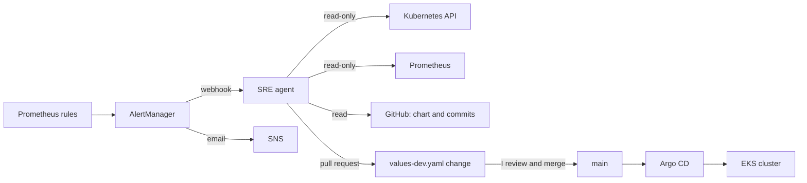

# SRE agent on AWS EKS

An SRE agent that investigates alerts on an EKS cluster and proposes fixes as
pull requests. A human approves every change.

I built the platform first: Google's Online Boutique shop, moved to AWS with
Terraform, Argo CD and GitHub Actions. Then I added the agent
([`src/sreagent`](src/sreagent/)) and an evaluation that checks it in CI.

## Results at a glance

Six real incidents on the dev cluster, 4 to 12 October 2026. I injected five
of them as memory cuts; the first was a real misconfiguration.

| # | Incident | Agent's pull request | Evidence score | Fault merged → fix PR opened |
|---|---|---|---|---|
| 1 | emailservice pods replaced every 5 minutes | None: the fix was a chart template change, outside what the agent may change. I fixed it in [#12](https://github.com/kolade86/online-boutique-aws-eks/pull/12) | – | – |
| 2 | recommendationservice memory cut to 40Mi | [#19](https://github.com/kolade86/online-boutique-aws-eks/pull/19) | not scored yet | 2 min 21 s |
| 3 | recommendationservice cut to 40Mi, then 24Mi | [#25](https://github.com/kolade86/online-boutique-aws-eks/pull/25) | 96 | 6 min 44 s, from the first cut |
| 4 | recommendationservice cut to 24Mi | [#29](https://github.com/kolade86/online-boutique-aws-eks/pull/29) | 98 | 2 min 32 s |
| 5 | recommendationservice cut to 24Mi | [#32](https://github.com/kolade86/online-boutique-aws-eks/pull/32) | 100 | 3 min 4 s |
| 6 | paymentservice cut to 24Mi | [#36](https://github.com/kolade86/online-boutique-aws-eks/pull/36) | 100 | 8 min 47 s |

| Measure | Result |
|---|---|
| Agent pull requests merged | 5. I reviewed and merged each one. A sixth, [#26](https://github.com/kolade86/online-boutique-aws-eks/pull/26), duplicated #25; I closed it, and it led to [#27](https://github.com/kolade86/online-boutique-aws-eks/pull/27) |
| Wrong answers that opened a pull request | 0 |
| Fastest fix | 2 min 21 s from the fault merging to the fix PR (#19). The investigation itself took 22 s |
| Recorded runs re-judged in CI | 28, with no wrong answer allowed a change |

The times include Argo CD's rollout and the wait before the alert fires, which
is up to 5 minutes for `HighMemoryUsage` and shorter for OOMKilled alerts.

## Architecture



The agent is a hand-written loop in Python, with no agent framework. It calls
Claude Sonnet 5.5 through the Anthropic API.

## How the agent decides

Before it reports, the agent fills in a structured assessment. Code turns that
into an evidence score from 0 to 100. The model never states the number.

- **Observed-cause rule.** A change needs a cause the agent observed, not one
  it inferred. Observed means it cited both ends: the failure in the cluster
  (pods, events, logs, metrics), and the setting or commit that explains it.
- **Thresholds.** A score of 70 for a change, 85 for an image rollback.
- **Honest doubts cost nothing.** What the agent could not rule out or verify
  is listed for the reviewer. It does not lower the score.

Safety limits, enforced in code:

- **Read-only access.** A namespaced Kubernetes Role with no access to
  Secrets. The agent never changes the cluster.
- **Allow-list.** Its only write is a pull request on
  `helm/online-boutique/values-dev.yaml`: CPU and memory, replica counts, HPA
  minimum and maximum, or a rollback to a recent image tag. The check runs on
  the resulting diff, not on what the model says it changed.
- **Never pushes to main.** It writes only to `sre-agent/<id>` branches.
- **One pull request per incident.** Later alerts for the same service are
  added to the open PR as comments.
- **Budget.** 15 tool calls and one investigation at a time.

## One real incident: paymentservice at 24Mi

1. I merged [#35](https://github.com/kolade86/online-boutique-aws-eks/pull/35),
   which cut paymentservice memory to 24Mi. Argo CD rolled it out.
2. `HighMemoryUsage` fired: a pod above 90% of its limit for 5 minutes.
3. The agent made 8 read-only calls, in this order: pods, memory history, live
   limits, recent chart commits, chart defaults, events, usage against the
   limit, and the chart defaults again. Five went to the cluster and
   Prometheus, three to the repository.
4. Its first assessment scored 60, because its decisive check cited only
   metrics. The code refused a change.
5. Its ninth call read the live Deployment. The new ReplicaSet had the same
   image tag, so this was a settings change and not a code deploy. The second
   assessment scored 100, cause observed.
6. It opened [#36](https://github.com/kolade86/online-boutique-aws-eks/pull/36),
   restoring 64Mi and 128Mi, 54 seconds after the alert started. I reviewed
   and merged it.

## Evaluation

Each incident is saved as a case: the recorded tool outputs, the alert, and
what a right answer is. CI judges every recorded run again with the current
rule. It needs no cluster and no API key.

| Outcome | Meaning |
|---|---|
| pass | Right answer, and the expected change or none |
| missed fix | Right answer, but the expected change was not proposed |
| safe failure | Wrong answer, and no change allowed |
| critical | A change the case does not expect. Must be zero |

Model comparison on the one case models have been run on, the emailservice
incident. "Right" is a keyword check, not a human review. The replay counts
cover both versions of the scoring rule. Under the current rule there are 3
runs each for Sonnet and Opus, and none for Haiku.

| Model | Replays | Right | Note |
|---|---|---|---|
| Claude Haiku 4.5 | 6 | 0 | Blamed readiness probes every time. One run would have passed the first scoring rule, which led to the observed-cause rule. The evaluation command now refuses it |
| Claude Sonnet 5.5 | 9 | 9 | The agent's default |
| Claude Opus 5.5 | 6 | 6 | Called the same evidence "observed" once and "inferred" twice |

Full results: [`src/sreagent/regressions/REPORT.md`](src/sreagent/regressions/REPORT.md).
There are 6 cases, 28 judged runs and 210 unit tests for the agent.

## Platform

| Part | What I use |
|---|---|
| Cluster | EKS 1.35, 3 to 12 `t3.large` nodes, private subnets across 2 availability zones |
| Infrastructure | Terraform, 8 modules: networking, eks-core, data-persistence, platform-services, observability, cicd, argocd, bastion |
| Deploys | Argo CD with automated sync, self-heal and prune. Every deploy is a commit to `values-dev.yaml`, and `git revert` is the rollback |
| CI | GitHub Actions: unit tests on pull requests; 12 images built, scanned with Trivy and pushed to ECR on merge. Terraform checks, then plan, then a manual apply ([how that chain is enforced](terraform/README.md)). AWS access is by OIDC, with no stored keys |
| Monitoring | kube-prometheus-stack: Prometheus, AlertManager and Grafana, in-cluster and private. CloudWatch for logs, RDS and Redis |
| Secrets | AWS Secrets Manager, synced into the cluster by External Secrets Operator |
| Data | RDS PostgreSQL 17, ElastiCache Redis, EFS |
| Application | 11 shop services in Go, C#, Node.js, Python and Java, talking gRPC |

## Problems I found and fixed

| Problem | Fix |
|---|---|
| The HPA scaled emailservice to 1, and Argo CD restored the chart's 2, every 5 minutes | [#12](https://github.com/kolade86/online-boutique-aws-eks/pull/12): the chart omits `replicas` for services with an HPA |
| AlertManager never started: its config named a receiver that did not exist | [#14](https://github.com/kolade86/online-boutique-aws-eks/pull/14) |
| A merged image rollback started a build that wrote a new tag straight over it | [#13](https://github.com/kolade86/online-boutique-aws-eks/pull/13): chart-only changes no longer trigger a build |
| One fault fired three alerts, and two of them opened identical pull requests (#25, #26) | [#27](https://github.com/kolade86/online-boutique-aws-eks/pull/27): alerts are grouped into one incident per service |

## Limitations and next steps

- **The evaluation is small.** Models have run on one recorded case, 3 runs
  each under the current rule. That many clean runs cannot rule out a high
  failure rate; the report states the bound. More cases and runs come next.
- **The fixed incidents are alike.** All five were memory cuts I injected, four
  of them on one service.
- **The observed-cause rule checks which tools were cited, not what they
  showed.** A model that mislabels its evidence could still pass it. The
  allow-list and the human reviewer are the remaining checks.
- **The agent has been wrong.** After #12 deployed, it said the emailservice
  problem was still going. That is saved as a case, and it led to two new tools.
- **Dev-grade platform.** One environment, one agent replica with state in
  memory, Argo CD over HTTP with no domain, and a Terraform role with
  administrator access.

## Run it yourself

Without AWS, the agent's tests and the evaluation run from a full clone:

```bash
cd src/sreagent
pip install -r requirements.txt httpx
python -m unittest discover -s . -p 'test_*.py'
python cli.py scores          # every recorded run, judged again
```

With an AWS account:

1. Set the repository variables `AWS_ACCOUNT_ID`, `AWS_REGION` and
   `PROJECT_NAME`. The workflows have no hardcoded account.
2. Run `./bootstrap-backend.sh`, then `terraform apply` in
   `terraform/environments/dev`. Allow 20 to 30 minutes.
3. Run `aws eks update-kubeconfig --region us-east-1 --name online-boutique-dev-cluster`.
4. Run `bash src/sreagent/load-secrets.sh` to load the Anthropic key and the
   GitHub token into Secrets Manager. Do this before the build, so the agent
   starts with its keys.
5. Run the **Build Images** workflow. Argo CD then deploys the shop and the
   agent.

Details, the agent's configuration and how to capture a new case are in
[`src/sreagent/README.md`](src/sreagent/README.md). Argo CD access is in
[`terraform/modules/argocd/README.md`](terraform/modules/argocd/README.md).

## Credits

The shop is Google's
[Online Boutique](https://github.com/GoogleCloudPlatform/microservices-demo)
demo. I moved it from GCP to AWS: EKS for GKE, ECR for Artifact Registry,
ElastiCache for Memorystore, and an ALB for Google's load balancers. Its
shopping assistant needs Gemini and AlloyDB, so it is not deployed here.
